# 🌱 AgroGraph Intelligence (GraphRAG & KAG)

Sistema de Recuperação Aumentada por Grafos de Conhecimento (**GraphRAG & KAG**) aplicado à **inteligência agrícola e fundiária**, desenvolvido para o Projeto Final da disciplina *Tendências em Ciência da Computação* (Prof. Ricardo Roberto de Lima).

A plataforma integra dados fundiários do **SNCR/INCRA (Paraíba)**, séries municipais de produção agrícola do **IBGE (PAM/SIDRA)** e manuais técnicos não estruturados da **Embrapa** sobre Soja, Milho e Manejo Integrado de Pragas, mitigando alucinações via *grounding* semântico em subgrafos do **Neo4j**.

---

## 1. Arquitetura dos 4 Pilares

```mermaid
flowchart LR
    subgraph P1["1. Pipeline Text-to-Graph & ETL"]
        SNCR["SNCR-PB (CSV)"]
        IBGE["IBGE PAM (CSV)"]
        PDF["Embrapa (5 PDFs)"]
        ER["Entity Resolution (2 Camadas)"]
    end

    subgraph P2["2. Neo4j LPG Store"]
        LPG["Labels PascalCase + Relações Tipadas"]
        IDX["Constraints + B-Tree + Fulltext + Vector (1536d)"]
    end

    subgraph P3["3. Recuperação Híbrida & KAG"]
        HYB["Vector + Fulltext + Multi-hop Anti-Hub"]
        ALG["PageRank, Louvain & Shortest Path"]
        T2C["Text-to-Cypher (EXPLAIN + Timeout + fetch)"]
        LLM["Grounding Semântico + Citação de Caminhos"]
    end

    subgraph P4["4. Interface & Provenance"]
        UI["Streamlit + PyVis Interativo"]
    end

    P1 --> P2 --> P3 --> P4
```



### Estrutura do Repositório
```text
├── .streamlit/
│   └── config.toml            # Tema claro e paleta institucional do Streamlit
├── assets/                    # Logotipo e ícone SVG da aplicação
├── app.py                     # Ponto de entrada Streamlit
├── ui/
│   ├── theme.py               # Paleta semântica (ENTITY_COLORS), ícones e injeção de CSS
│   ├── components.py          # Cabeçalhos, KPIs, badges de confiança e config PyVis
│   └── styles.css             # Estilos globais do Design System
├── pages/
│   ├── 1_data.py              # Catálogo das fontes de dados
│   ├── 2_ingestion.py         # Fluxo guiado de limpeza, schema e ingestão
│   ├── 3_graph.py             # Explorador, consultas SNCR/IBGE e algoritmos de grafo
│   └── 4_consultation.py      # Consulta GraphRAG/KAG, subgrafo PyVis e Provenance
├── graph/
│   ├── connection.py          # Driver Neo4j singleton, database routing e TLS
│   ├── ontology.py            # Ontologia PascalCase, sinônimos e sanitização
│   ├── schema.py              # Constraints, índices B-Tree, Fulltext e Vector
│   ├── repositories.py        # Persistência LPG, limpeza segura e busca vetorial
│   ├── queries.py             # Consultas analíticas SNCR, IBGE e resumo do grafo
│   └── algorithms.py          # PageRank, Louvain e Shortest Path no subgrafo agronômico
├── ingestion/
│   ├── readers.py             # Leitores PDF (PyMuPDF + normalização), CSV e Excel
│   ├── chunking.py            # Fragmentação de páginas com overlap e ID SHA-256
│   ├── entity_extractor.py    # Extração NER/RE via OpenAI e resolução de municípios
│   ├── pipeline.py            # Ingestão de PDFs + Entity Resolution em 2 camadas
│   ├── sncr.py                # Leitor paginado SNCR
│   ├── sncr_transformer.py    # Transformação LPG e deduplicação segura de detentores
│   ├── sncr_pipeline.py       # Ingestão SNCR com amostragem uniforme (sample_step)
│   └── ibge_pipeline.py       # Parser dedicado dos blocos Área e Produção (IBGE PB)
├── retrieval/
│   ├── embeddings.py          # Geração de embeddings OpenAI em lote
│   ├── vector_search.py       # Busca vetorial e fulltext em Trecho e Entidade
│   ├── hybrid_search.py       # Busca híbrida + travessia multi-hop anti-hub + PageRank
│   ├── cypher_generator.py    # Text-to-Cypher protegido (Regex + EXPLAIN + Timeout + fetch)
│   └── kag_engine.py          # Motor KAG (modos no_context, vector e hybrid)
├── evaluation/
│   ├── questions.json         # 12 perguntas multi-domínio para avaliação
│   └── benchmark.py           # Benchmark comparativo com juiz LLM (faithfulness/recall)
├── utils/
│   ├── config.py              # Variáveis de ambiente (.env)
│   ├── paths.py               # Caminhos de dados
│   ├── file_utils.py          # Descoberta do catálogo de dados
│   ├── llm.py                 # Helper centralizado e lazy init do cliente OpenAI
│   └── graph_vis.py           # Renderizador interativo PyVis
└── tests/                     # Suíte de testes unitários e de integração (pytest)
```

---

## 2. Modelagem LPG no Neo4j

### Rótulos (Labels) e Relacionamentos
* **Núcleo Fundiário (SNCR)**: `ImovelRural`, `Municipio`, `RegistroDetencao`, `Detentor`, `Documento`.
  * Relações: `(:ImovelRural)-[:LOCALIZADO_EM]->(:Municipio)`, `(:ImovelRural)-[:POSSUI_DETENCAO]->(:RegistroDetencao)-[:REFERENTE_A]->(:Detentor)`, `(:ImovelRural)-[:EXTRAIDO_DE]->(:Documento)`.
* **Ponte Agrícola (IBGE PAM)**: `(:Municipio)-[:PRODUZ {ano, area_plantada_ha, quantidade_ton, fonte}]->(:CulturaAgricola)`.
* **Conhecimento Agronômico (Embrapa PDFs)**: `CulturaAgricola`, `Praga`, `PraticaAgricola`, `ProdutoAgricola`, `CondicaoAmbiental`, `Bioma`, `Regiao`, `Estado`, `Instituicao`, `Pessoa`, ligados por relações tipadas sanitizadas (`AFETA`, `CONTROLA`, `RECOMENDA`, `MANEJADA_COM`, etc.) e conectadas aos trechos via `(:Entidade)-[:EXTRAIDO_DE]->(:Trecho)<-[:CONTEM]-(:Documento)`.

### Constraints e Índices Aplicados (`graph/schema.py`)
* **Constraints de Unicidade**: `Entidade(id)`, `Documento(id)`, `Trecho(id)` e `Municipio(codigo_ibge)`.
* **Índices B-Tree / Range**: `Municipio(nome_normalizado, uf)`, `ImovelRural(codigo_sncr)`, `ImovelRural(area_total)`, `Entidade(tipo)`, `Entidade(nome)`.
* **Índices Fulltext**: `entidade_busca` (`Entidade(nome, descricao)`) e `trecho_busca` (`Trecho(texto)`).
* **Índices Vetoriais (1536 dimensões, cosseno)**: `trecho_embedding` (`Trecho(embedding)`) e `entidade_embedding` (`Entidade(embedding)`).

---

## 3. Decisões Metodológicas e Escopo dos Dados

1. **Limite do Neo4j Aura Free e Amostragem Uniforme (`sample_step = 6`)**:
   * O arquivo completo `data/structured/sncr/Imoveis_PB_01_11_2026.csv` contém **237.023 registros**, o que geraria mais de 700 mil nós — acima do teto de **200.000 nós** do Neo4j Aura Free.
   * Por isso, o pipeline aplica amostragem uniforme pelo índice global da linha (`sample_step = 6`, até 40.000 registros), preservando cobertura proporcional de **219+ municípios da Paraíba** sem estourar o banco. Contagens e áreas fundiárias são explicitamente rotuladas na interface e no motor KAG como referentes à amostra uniforme 1/6.
2. **Privacidade e Resolução de Entidades (`Detentor` e `Entity Resolution`)**:
   * Nos CSVs públicos do INCRA, os nomes dos titulares são mascarados com `*` (ex.: `JOSE ************`). A deduplicação canônica por nome/natureza jurídica só ocorre quando não há máscara `*`; registros mascarados mantêm chave determinística por linha global do arquivo para evitar fusão falsa de homônimos.
   * Nas entidades dos PDFs e do IBGE, aplicamos **2 camadas de Entity Resolution**: (1) canonicalização determinística + dicionário de sinônimos (`Milho (em grão)`, `Zea mays` → `Milho`) e (2) similaridade de cosseno em embeddings `tipo: nome` (fusão direta `>= 0.90` e confirmação via LLM na faixa `0.75..0.90`).
   * Menções a `Municipio` nos PDFs são resolvidas em memória contra o mapa oficial dos municípios da PB do SNCR (`nome_normalizado + uf`), evitando duplicação no grafo.
3. **Proteção Anti-Hub e Text-to-Cypher Seguro**:
   * A travessia multi-hop (`hybrid_search.py`), o `SHORTEST 1` (`algorithms.py`), o PageRank e o Louvain excluem explicitamente os rótulos `ImovelRural`, `RegistroDetencao`, `Detentor`, `Trecho` e `Documento` (além das relações fundiárias no padrão quantificado), evitando explosão combinatória em nós `Municipio` com milhares de imóveis.
   * O Text-to-Cypher valida as consultas em 3 camadas: bloqueio por regex `\b...\b` (incluindo `CALL`), pré-validação obrigatória via `EXPLAIN` (`query_type == "r"`), `timeout=10.0` no servidor e truncamento no cliente via `result.fetch(50)`.
4. **Dados da CONAB**:
   * Os arquivos `.xls` da CONAB (`data/structured/conab/`) trazem séries históricas agregadas por UF/Região e permanecem catalogados em `pages/1_data.py`, enquanto a ponte de produção municipal no grafo utiliza os dados do **IBGE PAM** por possuírem granularidade municipal compatível com o SNCR.

---

## 4. Instalação e Configuração

### Pré-requisitos
* Python 3.11+ (testado com Python 3.14)
* Instância Neo4j 5.23+ (ex.: Neo4j Aura Free)
* Chave de API da OpenAI

### Passos de Instalação
```bash
# 1. Criar e ativar o ambiente virtual
python3 -m venv .venv
source .venv/bin/activate

# 2. Instalar dependências
pip install -r requirements.txt

# 3. Configurar variáveis de ambiente
cp .env.example .env
```

Edite o `.env` com suas credenciais:
```env
OPENAI_API_KEY=sua_chave_openai
OPENAI_MODEL=gpt-4o-mini
OPENAI_EMBEDDING_MODEL=text-embedding-3-small
OPENAI_JUDGE_MODEL=gpt-4o

DATA_DIR=data

NEO4J_URI=neo4j+s://seu-id.databases.neo4j.io
NEO4J_USERNAME=seu_usuario
NEO4J_PASSWORD=sua_senha
NEO4J_DATABASE=seu_database
```

---

## 5. Ordem Obrigatória de Ingestão

Pela interface (`pages/2_ingestion.py`) ou via módulos Python, execute sempre nesta sequência para preservar a integridade dos vínculos:

1. **Passo 0 — Limpeza do Subgrafo de Conhecimento (se houver dados legados de PDF)**: `clean_knowledge_subgraph()`
2. **Passo 1 — Schema LPG & Normalização**: `create_schema()` + `ensure_municipio_normalized_names()`
3. **Passo 2 — SNCR-PB**: `ingest_sncr(..., sample_step=6, max_records=40000)`
4. **Passo 3 — Ponte IBGE (PAM)**: `ingest_ibge("data/structured/ibge/producao_agricola.csv", expected_uf="PB")`
5. **Passo 4 — Manuais Embrapa (PDFs)**: `ingest_pdf(...)` para os 5 PDFs em `data/unstructured/embrapa/`

---

## 6. Execução da Aplicação, Testes e Benchmark

### Interface Gráfica (Streamlit)
```bash
.venv/bin/streamlit run app.py
```

### Suíte de Testes (`pytest`)
Os testes unitários usam *mocks* e executam localmente sem consumir cota da OpenAI nem alterar o Neo4j Aura:
```bash
.venv/bin/pytest -v
```
Para incluir os testes de integração ao vivo contra Neo4j Aura e OpenAI:
```bash
RUN_INTEGRATION_TESTS=1 .venv/bin/pytest -v
```

### Benchmark Comparativo de Alucinação (3 Modos)
Executa as 12 perguntas de `evaluation/questions.json` nos modos `no_context`, `vector` e `hybrid`, medindo `faithfulness`, `entity_recall` e `citation_score` e gerando `evaluation/resultados_comparativos.md`:
```bash
.venv/bin/python -m evaluation.benchmark
```

---

## 7. Créditos e Tecnologias Utilizadas
* **Neo4j Python Driver (`neo4j`)**: persistência LPG, índices vetoriais/fulltext e execução Cypher.
* **OpenAI SDK (`openai`)**: extração NER/RE, geração de embeddings (`text-embedding-3-small`), Text-to-Cypher, síntese KAG e avaliação (*LLM-as-a-Judge*).
* **NetworkX (`networkx`)**: cálculo de centralidade (PageRank) e detecção de comunidades (Louvain) em subgrafos.
* **PyMuPDF (`pymupdf`), Pandas (`pandas`), `xlrd` & `openpyxl`**: extração de PDFs técnicos e leitura/manipulação dos datasets estruturados (SNCR, IBGE e CONAB).
* **Streamlit (`streamlit`) & PyVis (`pyvis`)**: interface web interativa e renderização de subgrafos de proveniência.
* **Pytest (`pytest`) & `python-dotenv`**: automação da suíte de testes e gerenciamento de variáveis de ambiente.
